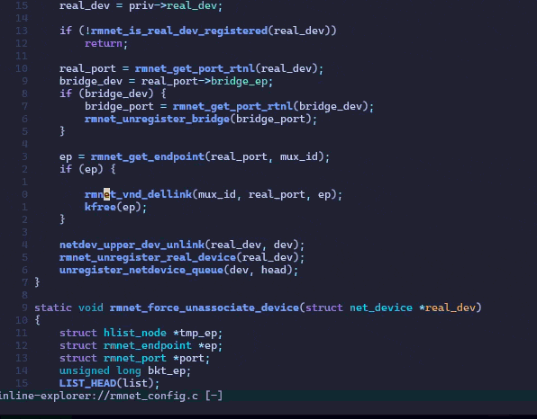

# inline-explorer.nvim

Read large codebases by **expanding function, type, and macro definitions
inline**, right where they are called — and expanding again inside what you just
expanded. No window-hopping, no floating peek windows.

Built for reading the Linux kernel, but **language-agnostic**: it works for any
language whose server implements `workspace/symbol`, and reads best with a
tree-sitter parser installed too (C/C++, TypeScript/JavaScript, Python, Rust,
Go, Lua, …).

Expansions happen in a dedicated **read-only copy** of the file, so your real
source is never touched. Each expansion is a real block of text you can move the
cursor into and expand further, and every block is a fold you can collapse when
you want the big picture back.



```
ret = do_work(x);
  /* v do_work (function_definition) */
  static int do_work(int x)
  {
      return helper(x) + 1;
        /* v helper (function_definition) */
        static int helper(int x) { return x << 1; }
        /* ^ helper */
  }
  /* ^ do_work */
```

## Requirements

- Neovim 0.10+
- **A language server** attached to your files that implements `workspace/symbol`
  (clangd, ts_ls / vtsls, pyright, rust-analyzer, gopls, lua_ls, …). Resolution is
  powered by its index.
- **The tree-sitter parser for your language** (`:TSInstall <lang>`, or via
  `nvim-treesitter`). It powers **highlighting the reading view**
  (see [Syntax highlighting](#syntax-highlighting-in-the-view)), C inline
  substitution (`:InlineExplorerInline`), and serves as the extraction fallback
  when the server yields no usable range.
- For C specifically, a `compile_commands.json` clangd can find — essential for
  the kernel:
  ```sh
  make defconfig
  ./scripts/clang-tools/gen_compile_commands.py
  ```

## Install

With [lazy.nvim](https://github.com/folke/lazy.nvim):

```lua
{
  "50n1cd347h9/inline-explorer.nvim",
  dependencies = { "neovim/nvim-lspconfig" },
  opts = {}, -- calls setup()
}
```

or manually:

```lua
require("inline-explorer").setup()
```

## Setup & verification

Getting the plugin *installed* and getting its *keymaps* to fire are two separate
things. Work through these in order.

**1. Confirm it is installed.** Any one of:

```vim
:Lazy                                       " look for inline-explorer.nvim, no ✗
:lua print(pcall(require, "inline-explorer"))  " prints  true
:InlineExplorer<Tab>                        " completes to the commands
```

**2. Set your leader key BEFORE plugins load.** The keymaps bind to whatever
`mapleader` is *at the moment `setup()` runs*. Put this at the **top** of your
`init.lua`, before `require("lazy").setup(...)`:

```lua
vim.g.mapleader = " "       -- note the spelling: map + leader
vim.g.maplocalleader = " "
```

Two things that silently break the `<leader>ee` maps (the commands still work):

- A typo in the variable name (`mapledaer`, `maploeader`, …) leaves `mapleader`
  at the default `\`, so the maps bind to `\ee` instead of `<space>ee`.
- Setting `mapleader` *after* the plugin loads. Reorder and restart.

Check it with:

```vim
:lua print(vim.inspect(vim.g.mapleader))    " expect  " "
```

If you would rather not depend on leader timing at all, bind explicit maps
yourself — these are independent of `mapleader`:

```lua
vim.keymap.set("n", "<space>eo", "<cmd>InlineExplorerOpen<cr>")
vim.keymap.set("n", "<space>ee", "<cmd>InlineExplorerExpand<cr>")
vim.keymap.set("n", "<space>ei", "<cmd>InlineExplorerInline<cr>")
vim.keymap.set("n", "<space>ec", "za")
vim.keymap.set("n", "<space>eq", "<cmd>InlineExplorerClose<cr>")
```

**3. Confirm a language server is attached.** Open a file and run `:LspInfo` (or
`:checkhealth lsp`). You should see a server attached (clangd, ts_ls, pyright, …).
If not, expansion fails with `no language server attached to the source buffer`.

## Usage

Open a file (with a language server attached), then:

| Keymap        | Command                     | Action                                              |
| ------------- | --------------------------- | --------------------------------------------------- |
| `<leader>eo`  | `:InlineExplorerOpen`       | Open a reading view for the current file            |
| `<leader>ee`  | `:InlineExplorerExpand`     | Block-expand the symbol under the cursor (any lang) |
| `<leader>ei`  | `:InlineExplorerInline`     | Inline in place: functions inlined, macros expanded (C) |
| `<leader>ec`  | (`za`)                      | Fold / unfold the expansion under the cursor        |
| `u` / `<C-r>` | —                           | Undo / redo the last expansion (inside the view)    |
| `]e` / `[e`   | `:InlineExplorerNext`/`Prev`| Jump to the next / previous expansion block         |
| `<leader>el`  | `:InlineExplorerList`       | Expansion blocks in the location list               |
| `<leader>eq`  | `:InlineExplorerClose`      | Close the reading view                              |

Expansions nest: move the cursor onto any function/macro inside an expanded body
(block) or inlined fragment (substitution) and expand again. `u`/`<C-r>` are
buffer-local snapshots of the view, so they undo/redo whole expansions without
touching your real files (native undo does not apply — the view is read-only).

Put the cursor on a function call or macro and expand it. Its body is spliced in
below, indented and folded-open. Move into that body and expand again to go
deeper. Folding a block collapses its subtree; unfolding reopens it — nothing is
re-fetched.

For deep sessions, `require("inline-explorer").breadcrumb()` returns the chain
of expansions the cursor is inside (`do_work > helper`), empty outside a view —
drop it into your statusline.

> Tip: until your keymaps are sorted, drive it entirely by command
> (`:InlineExplorerOpen`, then `:InlineExplorerExpand` on a symbol). The commands
> never depend on `mapleader`.

## Inline substitution (C)

`:InlineExplorerInline` (`<leader>ei`) does more than paste the definition
below the call — it **rewrites the call into the effect of the function body**,
the way a compiler inlines it, so the surrounding statement reads on its own. This
is C-only and requires the tree-sitter `c` parser.

Given `return snap != acquire(c);`, inlining `acquire` produces:

```c
int cpu = (c);
struct ct *p = per_cpu_ptr(CT, cpu);
return snap != (p->state & MASK);
```

How it works:

- **Parameters** are bound to their declared type (`int cpu = (c);`), reconstructed
  from the definition so arrays decay to pointers and a `0`/NULL argument keeps the
  right pointer type; `__auto_type` is a fallback for exotic declarators.
- **Simple functions** (straight-line, single trailing return) are rendered as a
  *pretty hoist*: setup statements lifted above the call, the returned expression
  spliced in place (parenthesised, so precedence is preserved).
- **Anything else** (early returns, loops, control flow) is rendered as a GNU
  **statement expression** `({ ... })`, with each `return E;` rewritten to
  `{ __ie_retN = E; goto __ie_endN; }`. There is no fallback to block-paste.
- **Callee labels** and **locals that would collide** with the caller scope are
  suffixed `name__ieN` so repeated/nested inlining stays correct.

### correct vs. readable

The `mode` option chooses the output style (toggle live with
`:InlineExplorerToggleMode`):

- **`correct`** (default) — the result is guaranteed to compile. Complex functions
  become GNU statement expressions with `return`→`goto`, and hoists are wrapped in
  a block after labels. Faithful to the original's semantics.
- **`readable`** — favours clean output: never emits `({...})` or `goto`, hoists
  the body top-to-bottom. Prettier, but **not guaranteed to compile or preserve
  semantics** for functions with early returns / labels / short-circuits.

`readable` has exactly one exception, and it suspends the whole
no-`({...})`-and-no-`goto` guarantee, not just the `({...})` half: a call
inside a *declaration* that cannot be hoisted, either because it does not
start its own line (`if (a > 0) { int v = f(a); ... }`) or because it follows
a bare label instead of sitting directly in a `{}` block (`L: int v = f(a);`,
or the same after a `case`/`default` label — gcc accepts a declaration there
by default and only `-Wpedantic` objects). The usual fallback — wrapping the
declaration in a block — would make the declared name local to that block, so
the rest of the enclosing block would silently read whatever it shadowed.
Both modes render it as a statement expression instead — always with a
`goto __ie_endN;`/`__ie_endN:;` pair, since the canonical printer rewrites
every `return` that way regardless of how many the callee has — which
splices in place and leaves scope alone. Correctness outranks the stylistic
promise.

```lua
require("inline-explorer").setup({ mode = "correct" }) -- or "readable"
```

### Tested against real source

Correctness is verified on **real OSS**, not just hand-written snippets:

- `tests/real_cjson_spec.lua` clones [cJSON](https://github.com/DaveGamble/cJSON)
  (pinned to tag `v1.7.19`) and, for **every** in-file call to a same-file
  static function, applies correct-mode substitution then has gcc **rebuild
  and run cJSON's test suite**. Every transform the engine accepts must
  compile and pass; today that is 188 out of 188.
- `tests/real_kernel_spec.lua` runs against real Linux kernel source
  (linux-6.12, `kernel/sched/core.c`), which is the workload this plugin
  was written for. Every other spec is a proxy, and the proxies hid a real
  defect for the project's whole life: resolution results were never
  memoized, so every keystroke reissued `workspace/symbol` and
  `textDocument/documentSymbol` for a name that had already been resolved.
  A repeat lookup costs under a millisecond on zlib, so nothing ever
  failed; measured with real clangd on `kernel/sched/core.c` it cost p50
  54.6ms, p90 166.0ms and 567.5ms at worst — the same as the first
  lookup, because there was effectively no second lookup. With the caches
  in place the same repeat walk drops to p50 0.0ms, p90 0.1ms.

  What the spec asserts is **structural, not a timing threshold**: the
  second lookup of a name must not reach the server at all, checked by
  counting profile spans (`locate:cached`/`extract:cached` against
  `locate:ok`/`extract:cold`/`extract:warm`). A slow machine cannot turn
  it red, and a cache that merely got lucky on timing cannot turn it
  green. Timings are printed alongside for information only. It also
  checks that editing the file retires the cached entry rather than
  serving a stale body.

  It needs a kernel tree whose `compile_commands.json` actually covers the
  target file — the spec verifies that itself, because a database of host
  tools only (which is what a partial kernel build leaves behind) would
  let clangd guess flags and every result would describe something other
  than kernel code. Point `IE_KERNEL_DIR` at the tree. CI builds a single
  object (`make kernel/sched/core.o`) rather than the whole kernel, and
  does **not** accept a `SKIP:` as green.

- `tests/real_zlib_spec.lua` does the same against
  [zlib](https://github.com/madler/zlib) (pinned to tag `v1.3.1`), a
  different flavour of C from cJSON's: state machines, goto-based error
  handling, bit manipulation, and functions declared through zlib's own
  `#define local static` macro. Adding it found **three real engine
  defects**, all now fixed: a caller whose parse tree has a preprocessor
  conditional straddling braces (ordinary kernel style) got an
  `ERROR`-node ancestor instead of a `function_definition`, silently
  switching off collision-renaming; a call whose statement did not start
  its own line (`hits++; f(x);`, `case 1: f(x);`, `else f(x);`) got the
  preceding code copied onto every hoisted line, which compiled but ran
  the wrong thing; and a project macro in type position (zlib's `local`)
  was mistaken for the real return type, which gcc only warns about by
  default and `-pedantic-errors` rejects outright. All three are pinned as
  regression cases in `tests/substitute_spec.lua`.

  What is left after those fixes is **8 residual failures**, pinned as an
  **exact set** (`known_failures` in `real_zlib_spec.lua`) rather than a
  bare count or a one-directional suppression list: the harness fails the
  run if a failure appears that is not on the list (a regression) OR if an
  entry on the list stops failing (fixed without the list being updated —
  a suppression list nobody has to maintain stops meaning anything). All
  eight are documented engine LIMITS, not silently-ignored bugs:

  - **One** (`adler32_z`) is a macro whose own body hardcodes an
    identifier instead of routing it through the macro's parameter list,
    so renaming that identifier for collision safety changes which
    variable the expanded macro touches — a wrong VALUE, not a syntax
    error, so it is caught only by rebuilding and running the project's
    own tests.
  - **Six** (`deflateEnd`, `deflateReset`, `deflate`, `deflate_stored`,
    `deflate_huff`, `deflate_rle`) call a helper function or macro whose
    own definition sits later in the same file than the call site the
    callee's body is being spliced into — true at the helper's original
    position, but not at the earlier position the splice lands at.
  - **One** (`gzvprintf`) takes a `va_list` parameter, which cannot be
    given a copy initializer in C (only `va_copy` may do that).

  Alongside `verify` (rebuild + run the project's own tests), a second,
  **deterministic** gate runs on every accepted transform:
  `gcc -fsyntax-only -Werror=implicit-function-declaration
  -Werror=implicit-int`. `verify` is a round trip (compress then
  decompress and compare), so it cannot see a SYMMETRIC break — making
  `adler32()` return a constant leaves both directions agreeing on the
  same wrong checksum, and the round trip passes regardless. The syntax
  gate has no such blind spot for the other 7 residual failures — each is
  an identifier the gate either resolves or does not, deterministically —
  but measuring (not assuming) what it actually buys: disabling the gate
  and rerunning the full spec reproduces the identical counts and the
  identical 8 failures via `make test`'s own build, with zlib's default
  `CFLAGS` and no `-Werror` anywhere. All 7 are hard, deterministic
  `error:`/`undefined reference` failures under the plain build too, not
  something that depends on an uninitialised stack slot. The gate's real,
  demonstrated value is speed — one `-fsyntax-only` pass over a single
  file instead of a full rebuild and test run — and a cleaner,
  single-file diagnostic, not catching a break the plain build would
  otherwise miss. (`adler32_z`'s defect is a wrong value rather than an
  unresolved identifier, so it is invisible to the syntax gate regardless;
  only `verify`'s round trip catches it.)

  Both specs' clones are pinned to a tag, not each project's default
  branch: an unpinned clone drifts as upstream commits land, silently
  moving the summary numbers and the `known_failures` exact-set pin for a
  reason that has nothing to do with this plugin.

  The summary line each spec prints is not just "how many passed":

  ```
  real zlib: sites=238  skipped-ambiguous=28  dead-branch=33  engine-accepted=177  built+passed=169  unverifiable-files=0  unverifiable-dead-sites=0
  ```

  - **`sites`** — every in-file call to an in-file function the harness
    looked at.
  - **`skipped-ambiguous`** — declined outright as genuinely ambiguous
    without a preprocessor: the callee name has more than one definition
    in the file, or the same name is also a macro. Not attempted at all.
  - **`dead-branch`** — a single, unambiguous definition, but this
    particular call site's own line does not survive the project's own
    `gcc -E` in this build (e.g. it lives under an `#ifdef` this harness's
    `./configure` never activates). The engine is never asked to
    transform it, so it counts as **neither accepted nor passed** —
    crediting it as either would report a transform as verified that gcc
    never actually compiled.
  - **`engine-accepted`** — the engine returned a transform for this site
    (as opposed to declining it, e.g. for an arity it cannot match).
  - **`built+passed`** — of the accepted transforms, how many both
    compiled (or, for zlib, passed the deterministic `gcc -fsyntax-only`
    gate too) AND left the project's own test suite passing. **This is
    the only number that means "verified correct."** `engine-accepted`
    minus `built+passed` is the failure count reported in `FAILURE(S)`
    below the summary line (pinned exactly for zlib, expected to be zero
    for cJSON).
  - **`unverifiable-files`** / **`unverifiable-dead-sites`** — both exist
    so that a site the harness could not confidently classify is visible
    rather than silently folded into a bucket it does not belong in. A
    `#line` directive or a failed `gcc -E` makes a whole file's
    dead-branch check untrustworthy (`unverifiable-files`); a call
    site whose blank-content dead-branch reading is contradicted by its
    own callee token surviving on a neighbouring line — the shape where a
    call sits inside a different, enclosing multi-line macro invocation —
    is flagged per-site instead (`unverifiable-dead-sites`). Both fail
    open into "attempted" rather than being dropped, and both are counted
    here rather than left to a per-file `print()` a monitoring grep would
    never see, so a reader does not mistake a site nobody actually
    verified for one that quietly passed.

- `tests/substitute_spec.lua` compiles+runs a focused set of shaped cases
  (pointers, early returns, labels, collisions, void, a kernel-style accessor).
- `tests/properties_spec.lua` and `tests/pbt_spec.lua` add **property-based
  testing** on top: a deterministic generator (`tests/lib/gen.lua`) builds
  UB-free random callees and splices them into nine caller contexts. The fast
  layer checks tree-sitter invariants over ~300 cases per run; the gcc layer
  builds and runs each program before and after substitution and requires
  byte-identical stdout — and whenever the engine chooses the pretty form, the
  canonical form of the same call must agree too. Failures shrink to a minimal
  counterexample and print their seed (`IE_PBT_SEED` / `IE_PBT_CASES` /
  `IE_PROP_CASES` control reproduction and budget). A zero-argument call
  wrapped as `(f()) & k` parses as a cast in tree-sitter-c (no semantic type
  info), so the engine's rejection of that shape is expected and exempted by
  the property layers.
- `tests/bench_spec.lua` and `tests/bench_lib_spec.lua` cover performance
  rather than correctness: structural invariants (one lookup and one
  extraction per expansion, a warm/cold attach cache, no double-resolve on a
  block-paste fallback) against a real clangd, and the percentile/noise-floor
  statistics layer they're built on. See [Regression testing](#regression-testing).

```sh
nvim --headless --clean -u NONE -c "luafile tests/real_cjson_spec.lua" -c "qa!"
nvim --headless --clean -u NONE -c "luafile tests/real_zlib_spec.lua" -c "qa!"
nvim --headless --clean -u NONE -c "luafile tests/substitute_spec.lua" -c "qa!"
nvim --headless --clean -u NONE -c "luafile tests/properties_spec.lua" -c "qa!"
IE_PBT_CASES=100 IE_PBT_SEED=42 \
  nvim --headless --clean -u NONE -c "luafile tests/pbt_spec.lua" -c "qa!"
```

Both real-source specs require `git` + network + `gcc` (zlib also needs `make`)
and skip cleanly if any is missing — except in CI, where `tests/real_zlib_spec.lua`
is specifically NOT allowed to skip (see the `real-source` job in
`.github/workflows/test.yml`): a clone or toolchain failure there must show up
as a red build, not a quietly-skipped green one.

Limitations: macros and variadic functions are not inlinable this way; the current
action rewrites the whole view buffer, so it resets any block-expansion folds in
the view.

## Macros

Macros have no type or structured body, so they cannot be transformed like
functions. Two ways to see one, under the same keys as functions:

- **`<leader>ei`** (smart inline) replaces the macro use **in place** with its
  expansion, fetched from the **live clangd** -- preferring the `ExpandMacro`
  tweak (its `workspace/applyEdit` is intercepted and kept out of the real
  file), with `textDocument/hover` scraping as the fallback -- so it respects
  your include paths, `#define`s and `#ifdef` state. The query runs against the
  original source: the view line is mapped back to the file line it came from,
  so it stays exact however far prior expansions have shifted things. A macro
  use sitting on inserted text (inside an expanded body) has no source
  position and falls back to block expansion.
- **`<leader>ee`** (block expand) drops the macro's definition below the use as a
  folded block, like any other symbol.

Both are read-only — your real file is not edited. (One theoretical exception:
a tweak reply straggling in seconds late, past the ~5 s interception window,
would reach Neovim's default `applyEdit` handler.)

## Configuration

Defaults:

```lua
require("inline-explorer").setup({
  keymaps = {
    substitute = "<leader>ei", -- smart inline (in place); the primary action
    expand = "<leader>ee",     -- explicit block-paste (also the fallback)
    toggle_fold = "<leader>ec",
    open = "<leader>eo",
    close = "<leader>eq",
    undo = "u",                -- buffer-local to the view
    redo = "<C-r>",            -- buffer-local to the view
  },
  indent = "  ", -- indent added per expansion level
  header = true, -- wrap each expansion in /* v name */ ... /* ^ name */
  mode = "correct", -- inline-substitution output: "correct" | "readable"
})
```

Set any keymap to `false` to skip it. Keymap strings are bound at `setup()` time,
so `<leader>` here follows the same timing rule as above.

## Syntax highlighting in the view

The reading view is a detached copy that no language server is attached to, so
its **semantic-token** highlighting (the server-driven colors) is not available
there. To keep the view from falling back to bare regex syntax, the plugin starts
**tree-sitter** highlighting on the view buffer explicitly. Install the parser for
your language (`:TSInstall <lang>`) and the view stays richly highlighted.

Note that once you expand a body mid-file the buffer is no longer valid C as a
whole; tree-sitter is error-tolerant and still highlights recognizable tokens,
but expect the odd imperfectly-colored region deep in a nesting.

## Measuring latency

If an expansion feels slow, let the plugin tell you where the time goes rather
than guessing:

```vim
:InlineExplorerProfile on     " start recording (off by default, free when off)
" ... use <leader>ee / <leader>ei a few times ...
:InlineExplorerProfile        " report
:InlineExplorerProfile open   " the raw log in a tab (also: path, clear)
```

Every span is appended to `stdpath("log")/inline-explorer-profile.log`, so a
session can be inspected afterwards — or watched live from another shell.

Each line carries an action id (`#3`), a sub-second timestamp, and the symbol
and file the span was about. All three exist because a log without them could
not answer the questions a slow session actually raises: which of these lines
belong to the keypress that felt slow, in what order they happened when a
whole action lands inside one second, and *which* definition was the
four-second one rather than merely that one existed.

```sh
tail -f ~/.local/state/nvim/inline-explorer-profile.log
```

```
2026-07-30T10:55:15.204 #3    locate:ok                       0.4ms  sk_alloc @ sock.h
2026-07-30T10:55:15.208 #3    extract:bufload                39.2ms  sk_alloc @ sock.h (4021L)
2026-07-30T10:55:15.211 #3    extract:attach                  1.1ms  sk_alloc @ sock.h (4021L)
2026-07-30T10:55:15.789 #3    extract:cold                  580.8ms  sk_alloc @ sock.h (4021L)
2026-07-30T10:55:15.790 #3    total:expand                  581.7ms  sk_alloc (18L, function_definition)
2026-07-30T10:55:16.402 #4    extract:cold                  208.6ms  tcp_v4_connect @ tcp_ipv4.c (3600L)
2026-07-30T10:55:16.514 #4    macro:tweak                   111.8ms
2026-07-30T10:55:16.517 #4    rewrite                         3.2ms
2026-07-30T10:55:16.518 #4    total:inline-macro            332.0ms  tcp_v4_connect
```

`extract:bufload` is the plugin reading the definition file off disk;
`extract:attach` is handing it to the server; `extract:cold` is then the
server's own preamble build. They used to be one number, which meant a
four-second extract could not be attributed to any of them.

Span names read as `stage:variant`, and the end-to-end numbers all start with
`total:`, so they group together in the report. `extract:cold` means the plugin
made the server open a definition file it did not have open yet — the case that
costs a preamble build; `extract:warm` is one that was already open.
`substitute:rejected-variadic` and friends say why an in-place inline was
declined instead of just that it was.

`:InlineExplorerProfile` aggregates the same data in memory:

```
span                       n     total     mean      max     last
----------------------------------------------------------------
extract:cold               2      789ms     395ms     581ms     209ms
total:expand               1      582ms     582ms     582ms     582ms
total:inline-macro         1      332ms     332ms     332ms     332ms
macro:tweak                1      112ms     112ms     112ms     112ms
locate:ok                  3        3ms       1ms       2ms       2ms
rewrite                    1        3ms       3ms       3ms       3ms

action span                              ms  detail
------------------------------------------------------------------------------
#3     extract:cold                  580.8ms  sk_alloc @ sock.h (4021L)
#4     extract:cold                  208.6ms  tcp_v4_connect @ tcp_ipv4.c (3600L)
#4     macro:tweak                   111.8ms
```

The table aggregates by stage; the list below it names the individual worst
spans. The first tells you which stage costs most across a session, the second
tells you which single call was the slow one — a different question, and
usually the one being asked.

The three `extract:` variants are the three costs, and telling them apart is
the point of the labels:

- `extract:cold` — the server had to open a definition file it did not have
  open, and build its preamble. Measured on linux-6.12 (defconfig, clangd
  18.1.3, reading `kernel/sched/core.c`, probing `include/linux/sched.h`):
  p50 178ms.
- `extract:warm` — the file was already open, so no preamble, but the plugin
  still asked the server. Same measurement: p50 11ms.
- `extract:cached` — the plugin had already resolved this symbol and did not
  ask the server at all. On the same kernel source, p50 0.1ms.

The first case gets a shorter budget than the rest of the plugin's LSP calls
(`resolver._cold_timeout_ms`, 1200ms, against `_timeout_ms`'s 4000ms), which
is the opposite of what it looks like it should be. A first touch normally
answers in 380–650ms, but occasionally a small header does not answer at all
within seconds — and the only thing a long budget bought there was four
seconds of waiting before the same tree-sitter fallback a short one reaches
at once. Cutting it is safe because the attachment survives the timeout and a
timed-out result is never cached, so looking at the same symbol again asks
the server against a preamble it has meanwhile finished building (measured at
1.3ms, then 0.5ms, after a forced timeout on the first). You get an instant
answer now and the server's own answer next time, instead of waiting for the
instant answer.

The plugin keeps the last few definition files attached to stay out of the
first case, and caches resolution results to stay out of the second
(`:InlineExplorerProfile clear` wipes both the report and the log between
experiments).

Enable it permanently with `setup({ profile = true })`; set
`require("inline-explorer.profile").logfile = false` to keep it in memory only.

### Regression testing

Latency is not left to whoever happens to notice. `tests/bench_spec.lua`
drives the real actions against a real clangd on a generated fixture and
asserts the properties that hold regardless of machine speed — an expansion
costs exactly one lookup and one extraction, a second symbol from an
already-open header is warm, a block-paste fallback does not re-resolve, a
definition in the current file opens nothing, and a macro resolves through the
tweak rather than the hover scrape. Those are the pass/fail gate.

Timings are reported alongside as percentiles (p50/p90/MAD over 15 reps with 3
discarded, cold and warm kept as separate populations) and compared against
`tests/bench_baseline.json`, with the tolerance the larger of a measured noise
floor, 20% of the baseline, and a small absolute floor. But the structural
invariants above are the gate everywhere, on your machine and in CI, because
they do not depend on the clock. The timing comparison can fail on an idle
local machine and that is meaningful there. In CI it cannot be trusted the
same way: a contended runner slows both halves of the noise-floor measurement
together, so the floor stays small while the whole run is actually running
hot, and a steady slowdown is indistinguishable from a real regression — so CI
sets `IE_BENCH_TIMING_GATE=0`, which reports the timing comparison as a
warning instead of a failure. A pure slowdown with no structural change is
something a human reads out of the CI log, not something CI turns red for on
its own.

```sh
IE_BENCH_CLANGD=/path/to/clangd \
  nvim --headless --clean -u NONE -c "luafile tests/bench_spec.lua" -c "qa!"
```

`IE_BENCH_REPS` / `IE_BENCH_WARMUP` adjust the sample size;
`IE_BENCH_WRITE_BASELINE=1` records a new baseline;
`IE_BENCH_TIMING_GATE=0` downgrades vs-baseline timing failures to warnings
(what CI sets; structural invariants are unaffected).

## Buildroot / cross-compiled kernel

The plugin itself does not change — the work is getting clangd happy against a
cross build.

1. **compile_commands.json for the kernel** lives in the Buildroot build tree.
   After building, run the kernel's own generator there:
   ```sh
   cd output/build/linux-<version>
   ./scripts/clang-tools/gen_compile_commands.py
   ```
2. **Teach clangd the cross toolchain.** The compile commands reference
   Buildroot's cross gcc, so clangd needs `--query-driver` to trust it and pull
   the built-in include paths — otherwise you get missing-header errors:
   ```lua
   require("lspconfig").clangd.setup({
     cmd = { "clangd", "--query-driver=/abs/path/to/output/host/bin/*", "--background-index" },
   })
   ```
3. **Other C packages** (`output/build/<pkg>-<ver>/`): CMake packages emit
   `compile_commands.json` when `CMAKE_EXPORT_COMPILE_COMMANDS=ON`; for
   autotools/Makefile packages wrap the build with [`bear`](https://github.com/rizsotto/Bear):
   `bear -- make`.

## Troubleshooting

| Symptom                              | Cause / fix                                                        |
| ------------------------------------ | ----------------------------------------------------------------- |
| `<leader>ee` does nothing, commands work | `mapleader` not set to space before load, or a typo. See [Setup](#setup--verification). |
| `open a reading view first`          | Run `:InlineExplorerOpen` first.                                  |
| `no language server attached ...`    | No server attached — check `:LspInfo`.                          |
| `no symbol named 'x'`                | The server's index does not cover it (for C, check `compile_commands.json`). |
| View looks washed out                | Install the tree-sitter parser for the language (`:TSInstall <lang>`). |

## How it works

- **View** — a scratch copy of the source buffer, `nomodifiable`,
  `foldmethod=manual`, with tree-sitter highlighting started explicitly.
- **Resolver** — looks the symbol up by name via the server's `workspace/symbol`,
  then asks the server for the definition's full range via
  `textDocument/documentSymbol` (tree-sitter extraction and a brace heuristic
  remain as fallbacks when no server range is available). Name-based lookup is
  what makes nesting possible: inserted text has no real file position to query by.
- **Expander** — splices the body below the call line, tracks it with extmarks,
  and wraps it in a fold.

## Known limitations

- **No server semantic highlighting in the view** — tree-sitter is used instead
  (see above).
- **Name-based resolution.** Symbols that share a name (C `static` functions in
  different files, TS overloads / re-exports, …) may resolve to the wrong one. The
  exact-name match picks the server's first hit.
- **Coverage depends on the server.** A definition is only found if the server's
  `workspace/symbol` returns it, and its exact extent comes from the server's
  `textDocument/documentSymbol`. Without a usable server range, a tree-sitter
  parser (if installed) or a C-family brace heuristic takes over.
- **C macros show their `#define` body**, not a fully flattened expansion — which
  is usually what you want when exploring, since you can keep expanding identifiers
  inside it.
- **Recursion guard is ancestor-only**: a symbol will not expand inside its own
  body, but mutual recursion across siblings is not detected.

## TODO
- test with Linux Kernel

## License

MIT
